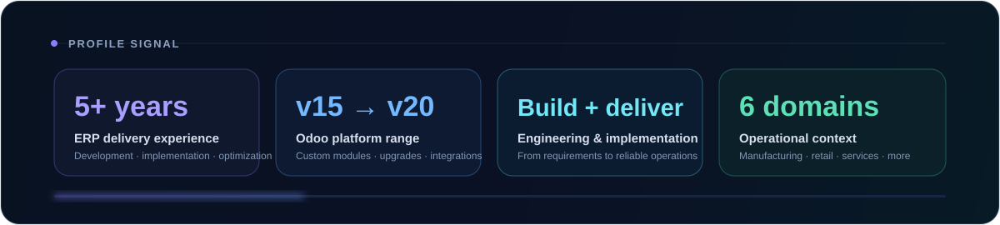
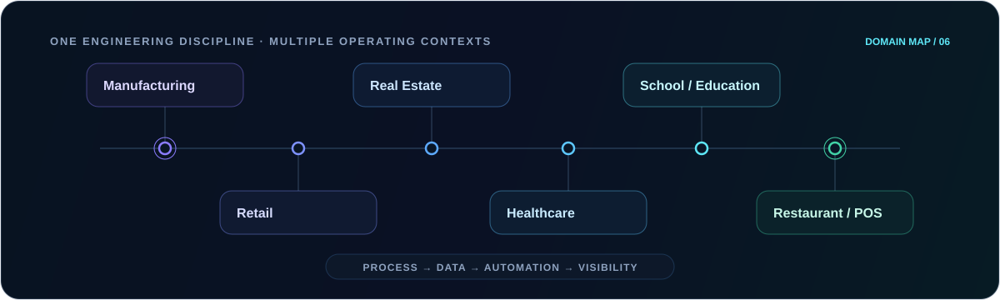

 

## Engineering ERP systems around real operations

I am a software engineer specializing in **Odoo ERP development and implementation**. For more than five years, I have worked across Odoo v15–v20—translating operational requirements into maintainable modules, connected workflows, useful reporting, and reliable business automation. My experience spans manufacturing, retail, real estate, healthcare, education, and restaurant/POS environments.

## Technical operating system

<table>
  <tr>
    <td width="33%" valign="top"><strong>ERP / Odoo</strong> Odoo v15–v20 · Custom modules · ORM · Security · Reporting · Integrations</td>
    <td width="33%" valign="top"><strong>Backend & data</strong> Python · PostgreSQL · XML · QWeb · Business logic · Data migration</td>
    <td width="33%" valign="top"><strong>Frontend & operations</strong> JavaScript · OWL · Ubuntu · Git · Deployment support · Optimization</td>
  </tr>
</table>

## What I build

| Business systems | Engineering work |
| --- | --- |
| Tailored ERP modules and cross-team workflows | Odoo customization, integration, and migration |
| Accounting, compliance, and ZATCA/e-invoicing flows | Dashboards, QWeb reports, and decision-ready views |
| Manufacturing, inventory, retail, and POS solutions | Performance analysis and workflow optimization |
| Real estate, healthcare, and education operations | Ubuntu server setup and deployment support |

My approach connects implementation detail with the process behind it: understand the operation, model it clearly, then deliver a system teams can use and maintain.

## Domain experience

## Current focus

This profile will grow through focused, public work that demonstrates engineering judgment without reproducing private client systems.

- **Odoo projects** — compact modules, implementation patterns, and UI explorations
- **Python engineering** — automation, data tooling, and maintainable service patterns
- **ERP dashboards** — operational views and reporting concepts built around clear decisions
- **Server & DevOps utilities** — deployment helpers, diagnostics, and repeatable setup notes
- **Health research tooling** — research-oriented Python explorations using public or synthetic data

> **Public showcase policy**
>
> Portfolio repositories may include selected screenshots, concise case summaries, implementation notes, and short illustrative snippets. Proprietary modules, sensitive business rules, client data, and complete private workflows remain confidential by design.

## Start a conversation

I am based in **Jeddah, Saudi Arabia** and open to remote and international roles, ERP consulting, and focused engineering collaborations.

  Software engineering for business systems that need clarity, control, and room to scale.

